# Казанцев Иван ЛА-2 Лабораторная №3 Вариант 5

# Задание 1

## Задача 5

### Текст задачи

Первый массив, размерностью n x m, заполняется данными, вводимыми с клавиатуры, так что заполнение ведется по строкам от первых элементов строки к последним.

Второй массив, размерностью n x n, заполняется так: элементы, лежащие ниже главной диагонали, являются случайными числами из интервала [-70; 150], а лежащие на главной диагонали и выше, являются случайными числами из интервала [17; 170].

Третий массив, размерностью n x n, заполняется для произвольного n так же, как для n=5:

### Требования из методички

Задания 1, 2 и 3 выполнить в виде методов одного класса.

Задание 1 реализовать в виде конструкторов (кроме них, могут быть и другие конструкторы). Класс содержит единственное поле – двумерный массив.

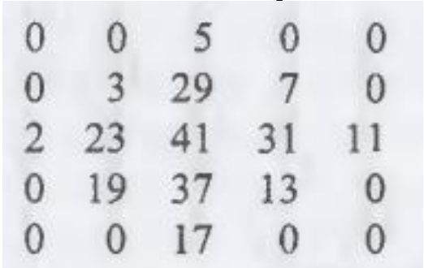

### Алгоритм решения

1. Создать класс Arrays для хранения двумерного массива.
2. Реализовать конструктор, который создает массив размером n x m и заполняет его целыми числами, введенными с клавиатуры.
3. Реализовать конструктор для создания квадратного массива размером n x n.
4. Заполнять элементы ниже главной диагонали случайными числами от -70 до 150, а элементы на главной диагонали и выше — случайными числами от 17 до 170.
5. Реализовать заполнение третьего массива простыми числами в форме ромба, оставляя остальные элементы равными нулю.
6. Вывести все три массива на экран с помощью метода ToString().

### Тестирование

### Пример работы

Была создана матрица 5x5 и введены числа от 1 до 25

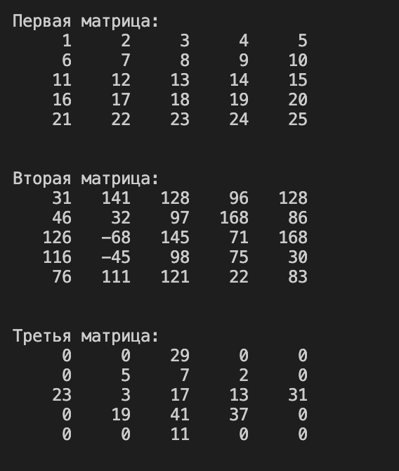

### Проверка ввода

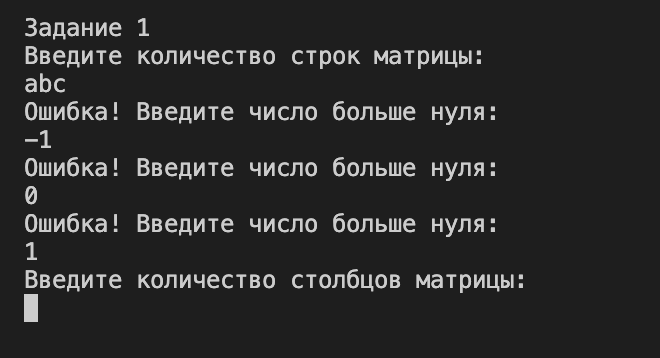

---

# Задание 2

## Задача 5

### Текст задачи

В двумерном массиве n x n выберите такую диагональ, параллельную главной, сумма элементов которой была бы максимальной.

### Требования из методички

Задания 1, 2 и 3 выполнить в виде методов одного класса.

### Алгоритм решения

1. Создать квадратную матрицу размером n x n и заполнить ее числами, введенными с клавиатуры.
2. Последовательно рассмотреть все диагонали, параллельные главной.
3. Для каждой диагонали вычислить сумму ее элементов.
4. Сравнить полученную сумму с максимальной найденной суммой.
5. Сохранить элементы диагонали с максимальной суммой.
6. Вывести исходную матрицу, максимальную сумму и элементы найденной диагонали.

### Тестирование

### Пример работы

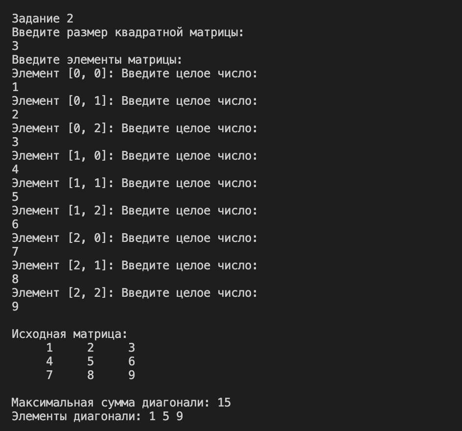

### Проверка ввода

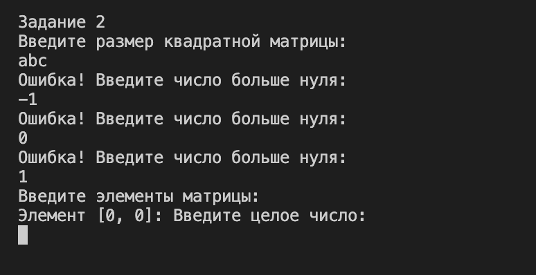

---

# Задание 3

## Задача 5

### Текст задачи

A^T*B-C^T

### Требования из методички

Задания 1, 2 и 3 выполнить в виде методов одного класса.

В задании 3 перегрузить необходимые операторы и посчитать значение матричного выражения (решение без перегрузки не принимается). Перегрузить метод ToString() — сформировать строку из двумерного массива для отображения его на экране в виде таблицы. Приложить в отчет скрин-шот проверки на онлайн-калькуляторе, чтобы показать, что выражение посчитано верно.

### Алгоритм решения

1. Создать три квадратные матрицы A, B и C одинакового размера.
2. Реализовать метод транспонирования матрицы Transpose().
3. Перегрузить оператор умножения * для умножения двух матриц.
4. Перегрузить оператор вычитания - для вычитания элементов соответствующих матриц.
5. Вычислить выражение A^T*B-C^T.
6. Переопределить метод ToString() для вывода матриц в табличном виде.
7. Вывести исходные матрицы и результат вычисления выражения.

### Тестирование

### Пример работы

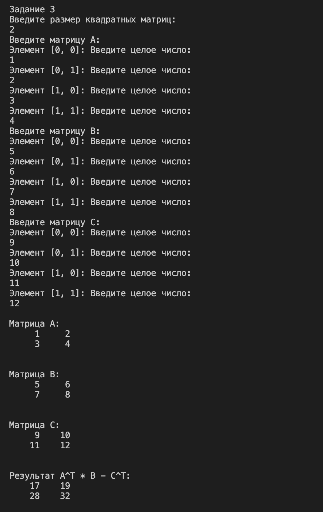

### Проверка ввода

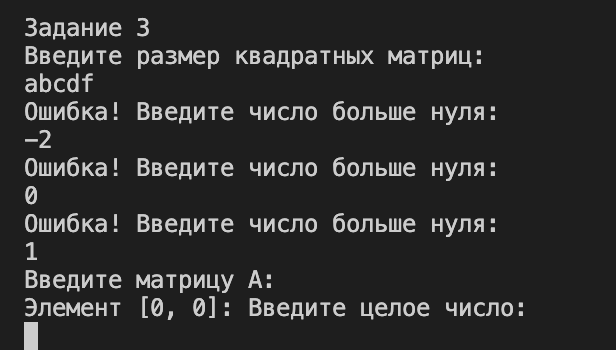

### Проверка в онлайн-калькуляторе

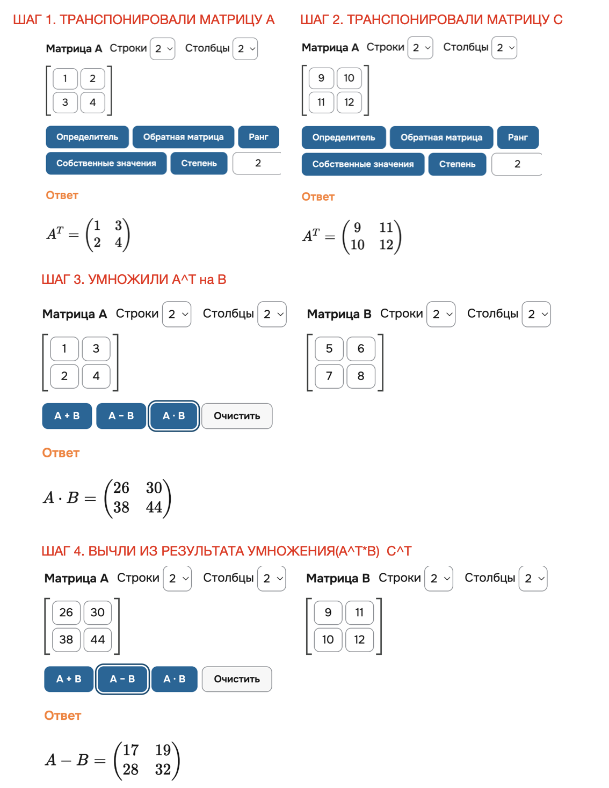

---

# Задание 4

## Задача 5

### Текст задачи

Из исходного файла получить новый файл, исключив повторные вхождения чисел.

### Требования из методички

Задания 4 – 8 выполнить в виде статических методов одного класса, но отдельно от заданий 1-3.

В задании 4 бинарные файлы, содержат числовые данные, исходный файл необходимо заполнить случайными данными, заполнение организовать отдельным методом.

### Алгоритм решения

1. Создать бинарный файл с целыми числами, заполненными случайным образом.
2. Считать числа из исходного файла.
3. Создать массив для хранения чисел без повторений.
4. Последовательно проверять каждое число на наличие среди уже сохраненных чисел.
5. Добавлять число в результирующий массив, если оно встречается впервые.
6. Записать числа без повторений в новый бинарный файл.
7. Вывести результат на экран.

### Тестирование

### Пример работы

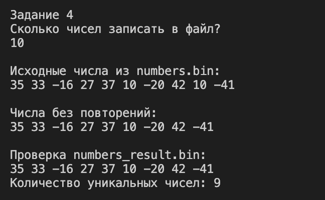

### Проверка ввода

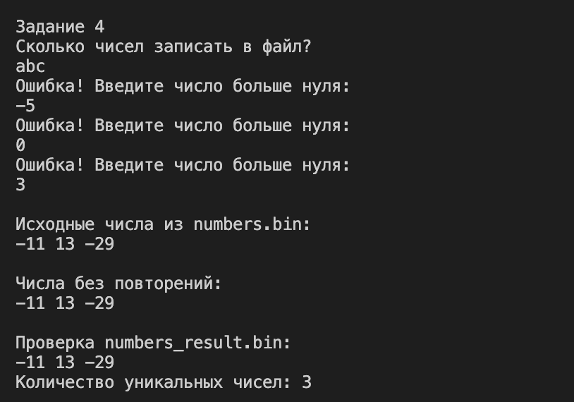

---

# Задание 5

## Задача 5

### Текст задачи

Файл содержит сведения об игрушках: название игрушки, ее стоимость в рублях и возрастные границы (например, игрушка может предназначаться для детей от двух до пяти лет). Получить название игрушек, цена которых не превышает k руб. и которые подходят детям 5 лет.

### Требования из методички

В задании 5 бинарные файлы содержат величины типа struct, заполнение исходного файла необходимо организовать отдельным методом, обязательно использовать xml сериализацию, решение без сериализации не принимается.

### Алгоритм решения

1. Создать структуру Toy для хранения названия игрушки, стоимости и возрастных границ.
2. Ввести сведения об игрушках с клавиатуры.
3. Записать данные об игрушках в бинарный файл.
4. Считать данные из бинарного файла.
5. Сериализовать массив игрушек в XML-файл.
6. Десериализовать данные из XML-файла.
7. Выбрать игрушки, стоимость которых не превышает k рублей и возрастной диапазон которых включает 5 лет.
8. Вывести названия и стоимость подходящих игрушек.

### Тестирование

### Пример работы

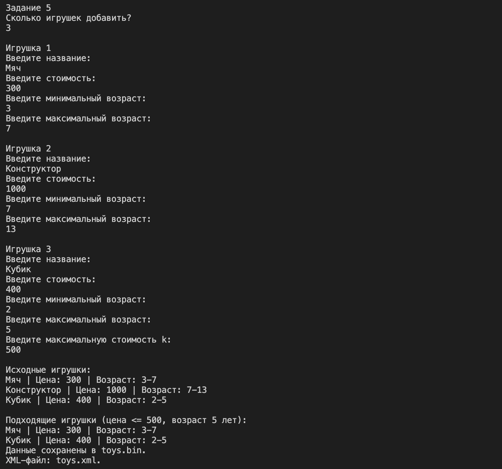

### Проверка ввода

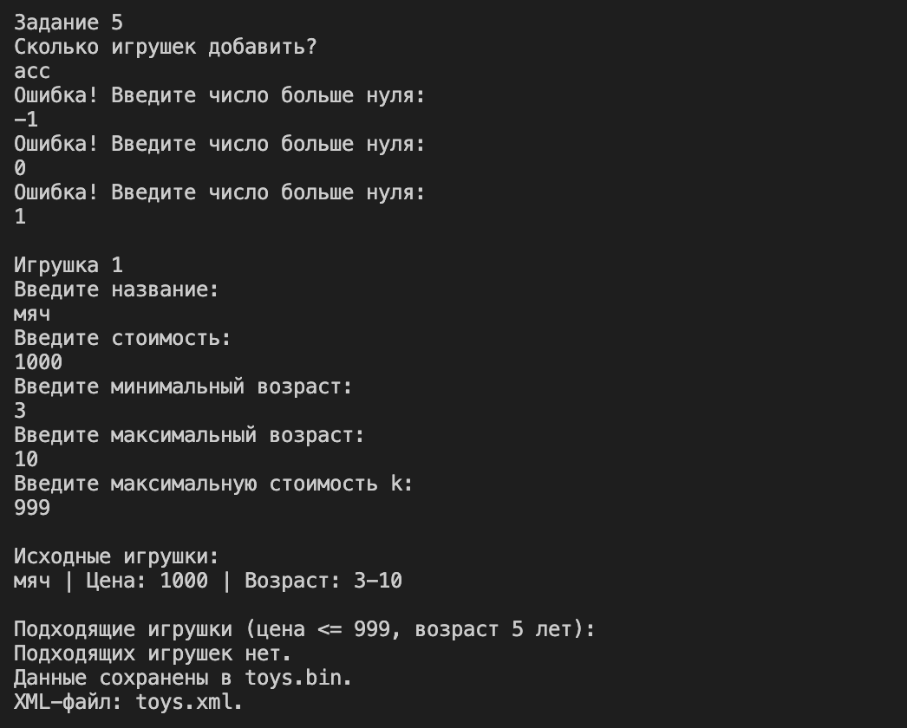

---

# Задание 6

## Задача 5

### Текст задачи

Для заданного файла возвратить true, если он содержит заданное число b, и false в противном случае.

### Требования из методички

В задании 6 в текстовом файле хранятся целые числа по одному в строке, исходный файл необходимо заполнить случайными данными, заполнение организовать отдельным методом.

### Алгоритм решения

1. Создать текстовый файл, содержащий целые числа, по одному числу в каждой строке.
2. Заполнить файл случайными целыми числами.
3. Считать заданное число b.
4. Последовательно считывать числа из файла.
5. Сравнивать каждое число с b.
6. Если число найдено, вернуть true.
7. Если число отсутствует в файле, вернуть false.
8. Вывести результат проверки на экран.

### Тестирование

### Пример работы

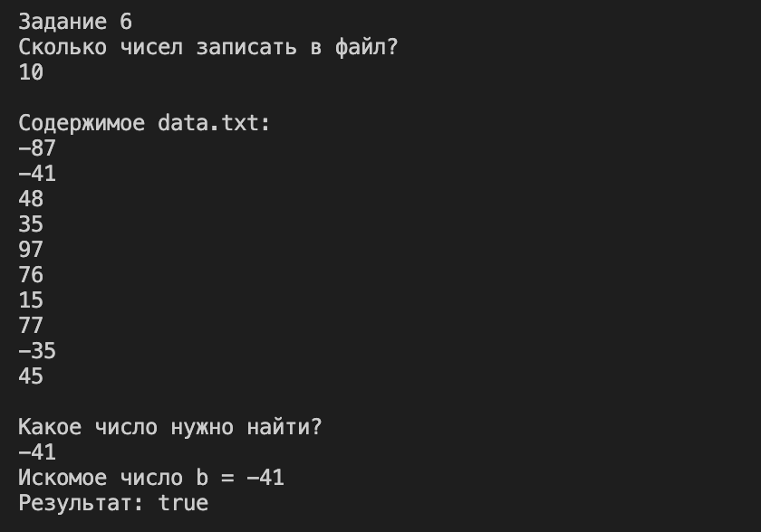

### Проверка ввода

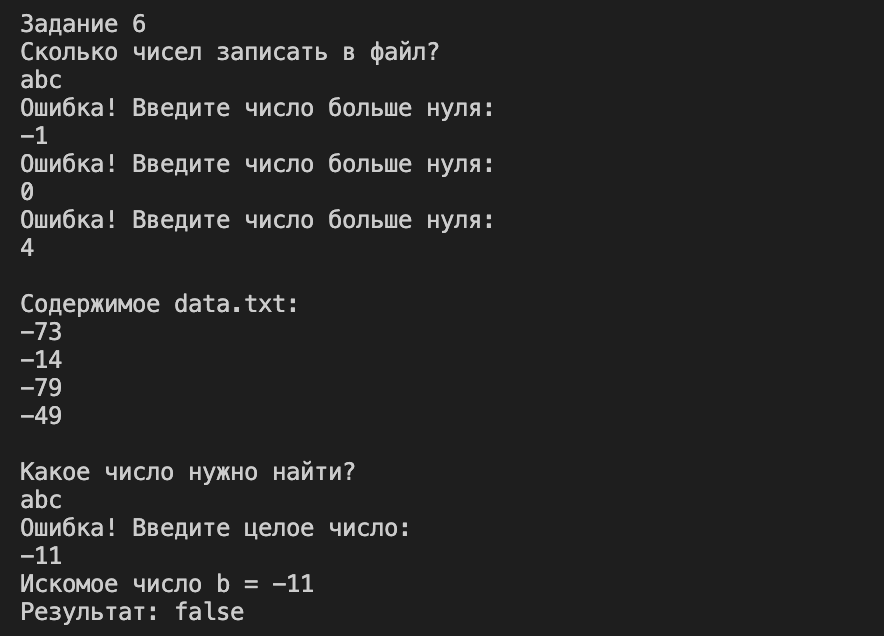

---

# Задание 7

## Задача 5

### Текст задачи

Вычислить сумму элементов, которые кратны заданному числу k.

### Требования из методички

В задании 7 в текстовом файле хранятся целые числа по несколько в строке, исходный файл необходимо заполнить случайными данными, заполнение организовать отдельным методом.

### Алгоритм решения

1. Создать текстовый файл, содержащий целые числа, по несколько чисел в каждой строке.
2. Заполнить файл случайными целыми числами.
3. Считать заданное число k.
4. Прочитать содержимое файла.
5. Разделить содержимое на отдельные числа.
6. Проверить каждое число на кратность k.
7. Сложить числа, которые делятся на k без остатка.
8. Вывести вычисленную сумму на экран.

### Тестирование

### Пример работы

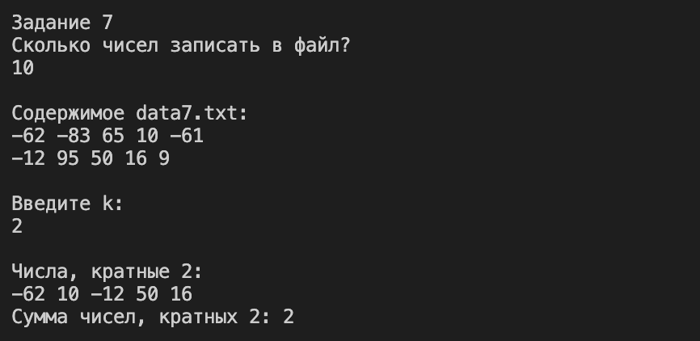

### Проверка ввода

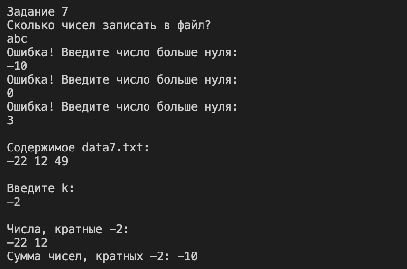

---

# Задание 8

## Задача 5

### Текст задачи

Переписать в другой файл строки, в которых нет цифр.

### Требования из методички

В задании 8 в текстовом файле хранится текст.
Необходимо решить по 1 задаче из каждого задания согласно вашему варианту. Каждое задание
оценивается по 1 баллу. Максимально за лабораторную работу можно получить 10 баллов (8 баллов
за решение задач + 2 балла за оформление отчета).

### Алгоритм решения

1. Создать текстовый файл и заполнить его строками, введенными с клавиатуры.
2. Последовательно считывать строки исходного файла.
3. Проверять каждый символ строки на наличие цифр.
4. Если в строке нет цифр, записать ее в результирующий файл.
5. Если строка содержит хотя бы одну цифру, не записывать ее в результирующий файл.
6. Вывести сообщение об обработке файла.

### Тестирование

### Пример работы

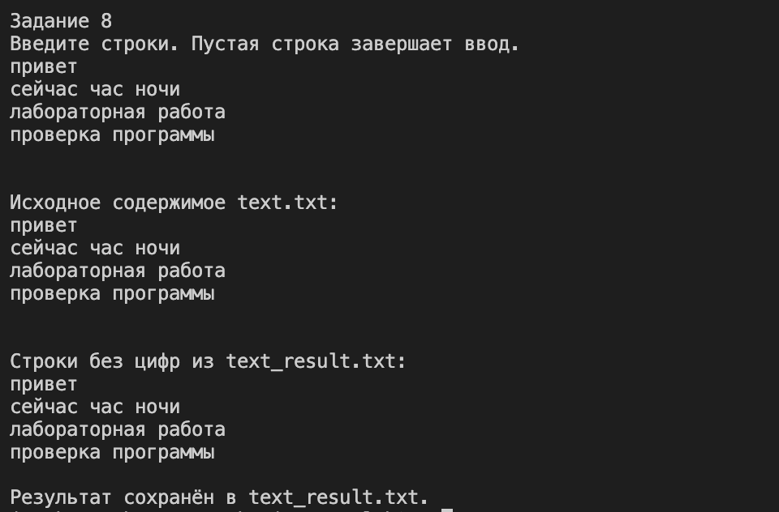

### Проверка ввода

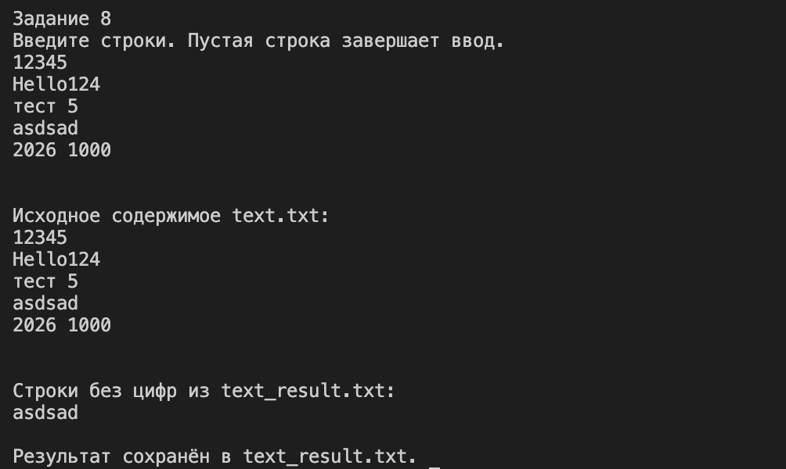
